.. _code-generation-editors:

######################
SCXML editors
######################

.. contents::
   :local:

.. note:: For designing hsmcpp state machines the recommended tool is
          :ref:`code-generation-hsm-ide`, which understands hsmcpp-specific
          concepts natively. The general-purpose SCXML editors below are
          documented as alternatives.

Unfortunately, there doesn't seem to be too many available free SCXML editors, and even less of
them are actively maintained. I tried to gather on this page all usable tools that I was able to find.

Qt Creator
================

Qt Creator is the easiest one to start with. Though personally, I feel like
arranging transitions is a bit sloppy. I hope they will add "snap-to-grid" feature in future releases.

Can be downloaded from:

- `GitHub repository <https://github.com/qt-creator/qt-creator>`__
- `Qt binary portal <https://download.qt.io/>`__
- installed together with `Qt SDK <https://www.qt.io/download>`__

.. warning:: Ubuntu version of Qt Creator crashes quite often when working with state machines. It's highly recommended to save often to avoid frustration.

.. warning:: using *parallel* element in version 4.14.2 on Ubuntu **crashes editor when saving file**. This happens after editing state machine for awhile and doesn't seem to occur if only a couple of modifications were made. Hopefully will get fixed.

|Editing HSM in Qt Creator|

Basics of how to define a state machine in Qt Creator can be checked
here:

-  `Editing State Charts in Qt Creator <https://doc.qt.io/qtcreator/creator-scxml.html>`__
-  `Qt SCXML and state machine tooling in Qt Creator <https://www.youtube.com/watch?v=9xqhq9nDiOg>`__

Now let's go through where hsmcpp-specific features are set **in the Qt Creator
UI**. For what each construct means and its SCXML-level format, follow the
cross-reference links.

Specifying callbacks in editor
------------------------------

For the meaning and format of the 4 callback types, see
:ref:`scxml-callbacks`. In Qt Creator they are entered as:

-  state changed -- **state->Invoke->srcexp** or **state->Invoke->src**:
   |State callback|
-  state entering -- **state->onentry->script->Content**:
   |State entering callback|
-  state exiting -- **state->onexit->script->Content**:
   |State exiting callback|
-  transition -- **transition->script->Content**:
   |State exiting callback|

Working with timers and actions
-------------------------------

For the list of timer/transition actions and their command format, see
:ref:`scxml-timers`. In Qt Creator, actions are entered under
**state->onentry** or **state->onexit**:

|Timer start action|

The resulting timer event (**ON_TIMER_<timer_id>**) can then be used as a
transition trigger: |Timer transition|

Conditional transitions
-----------------------

For the condition formats, see :ref:`scxml-conditional-transitions`. In Qt
Creator the condition is entered in **transition->cond**:
|Conditional transition|

Conditional entry points
------------------------

For what conditional entry points are and their SCXML format, see
:ref:`scxml-conditional-entry-points`. Qt Creator cannot define more than one
transition from an entry point directly, so this needs a manual XML edit.

First, create your substates, define an entry point and add a single
transition. |Multiple entries|

Now you need to save the file and open the SCXML file in a text editor
(Qt Creator doesn't allow editing SCXML files directly). Find your
section. |Original XML|

Modify it to look like this (ignore **<qt:editorinfo>** tag). Add as many
transitions as you need. |Modified XML|

After reloading the SCXML file in Qt Creator your HSM should look like this.
|Conditional entry points|

scxmlgui
========

Website: `<https://github.com/fmorbini/scxmlgui>`__

Simple editor written in Java. Requires a bit more manual work than Qt Creator, but does the job.
Binary can be downloaded from `GitHub repository <https://github.com/fmorbini/scxmlgui/blob/master/extra/fsm-editor.jar>`__.

|Editing HSM in scxmlgui|

YAKINDU Statechart Tools
========================

Website: `YAKINDU Statechart Tools <https://www.itemis.com/en/yakindu/state-machine/documentation/user-guide/inst_installing_yakindu_statechart_tools>`__

This tool comes with a lot of extra features, but what's important is that it has a state machine editor and a way to `export it in
SCXML format <https://www.itemis.com/en/yakindu/state-machine/documentation/user-guide/scxml_integration>`__.

.. note:: Editor is commercial, but has a free license for personal usage.

ScxmlEditor
===========

Website: `ScxmlEditor <https://github.com/alexzhornyak/ScxmlEditor-Tutorial>`__

Simple editor. Available only as a binary for Windows platform.

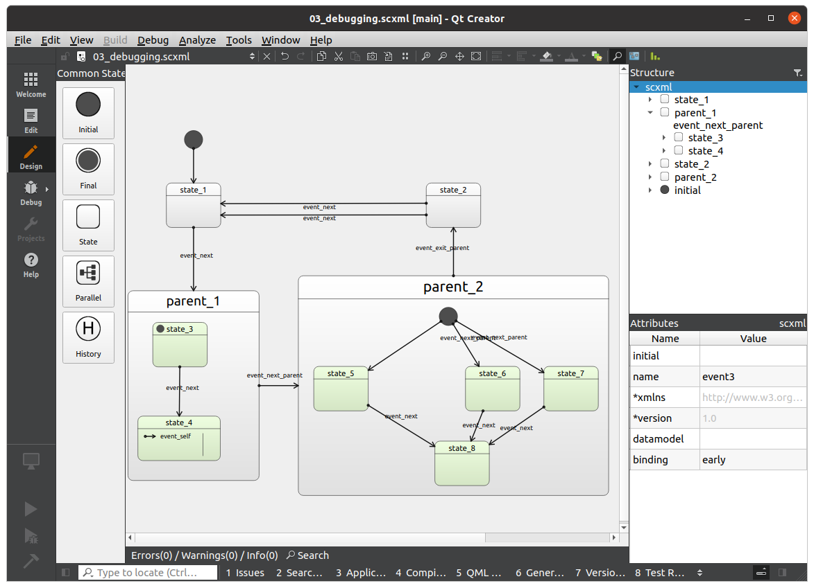
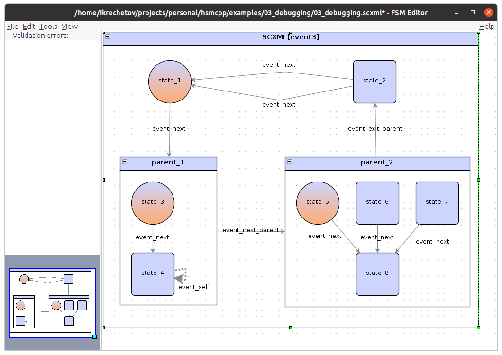
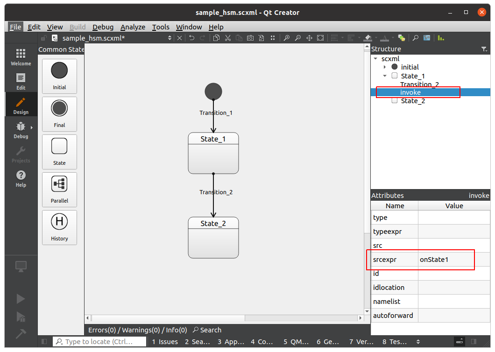
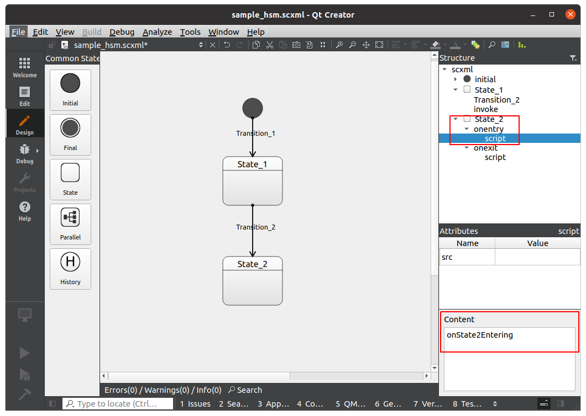
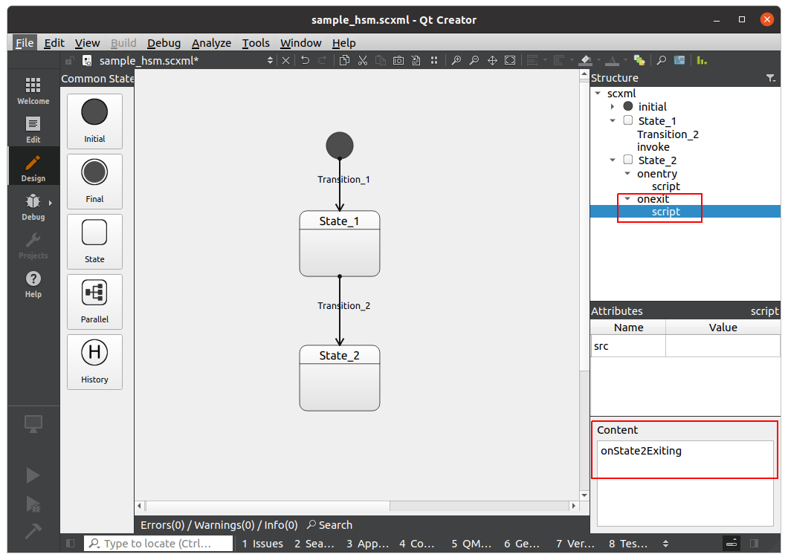
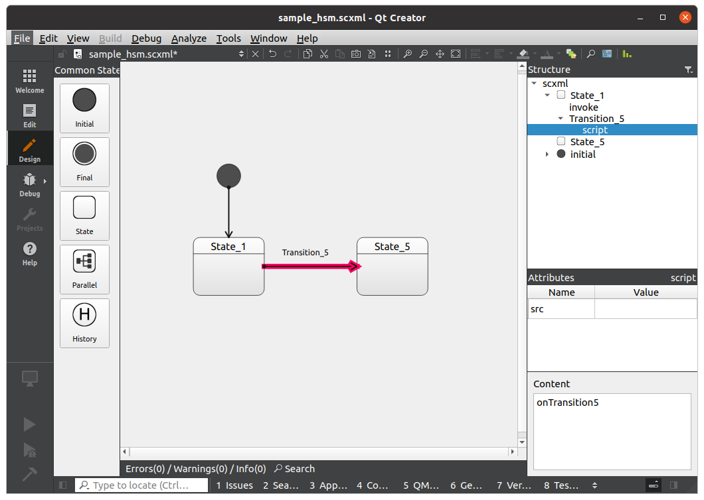
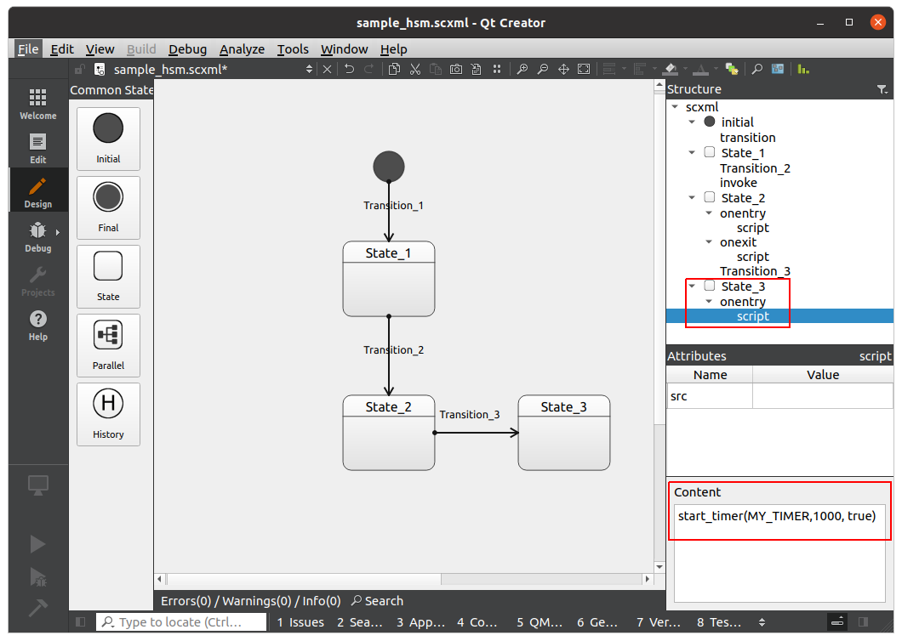
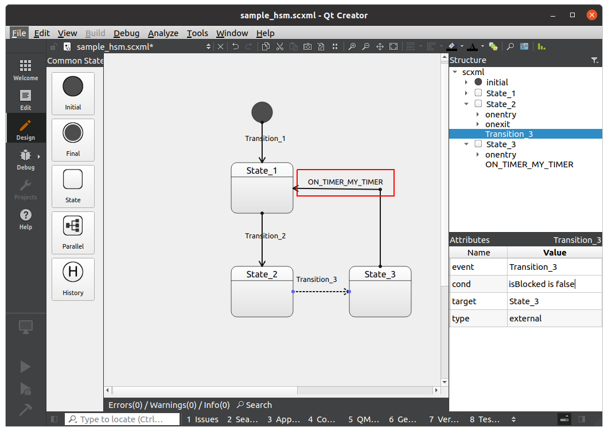
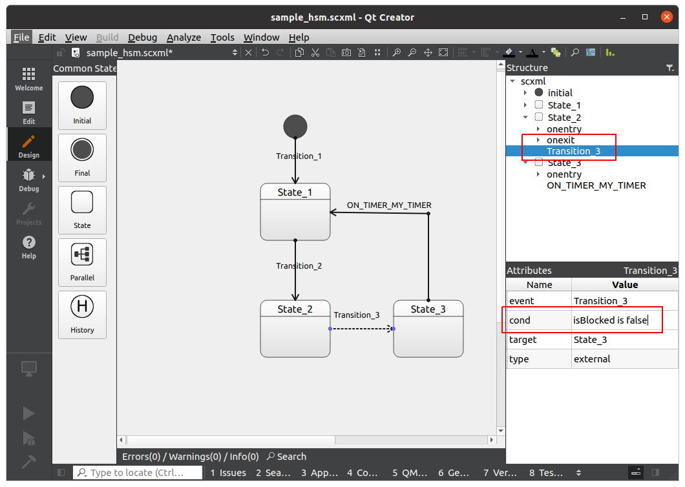
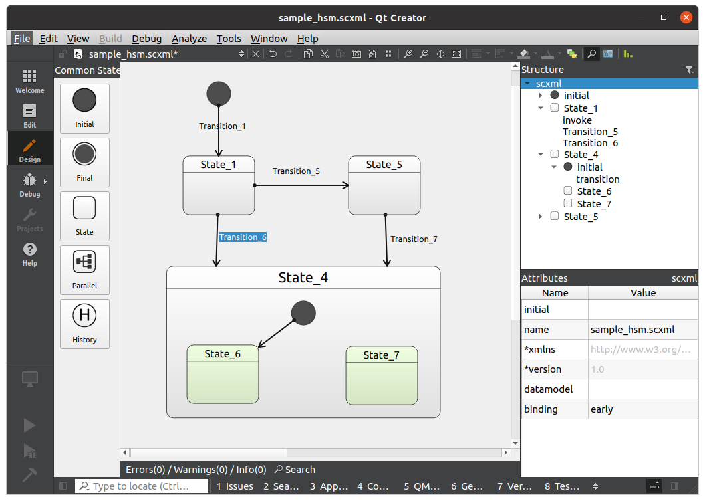
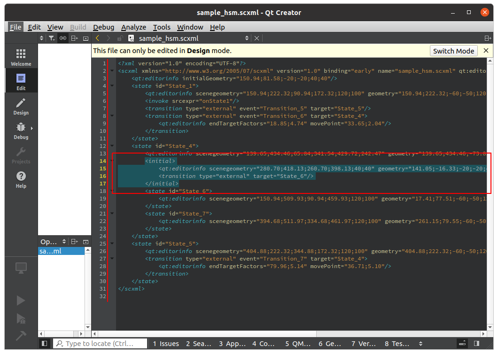

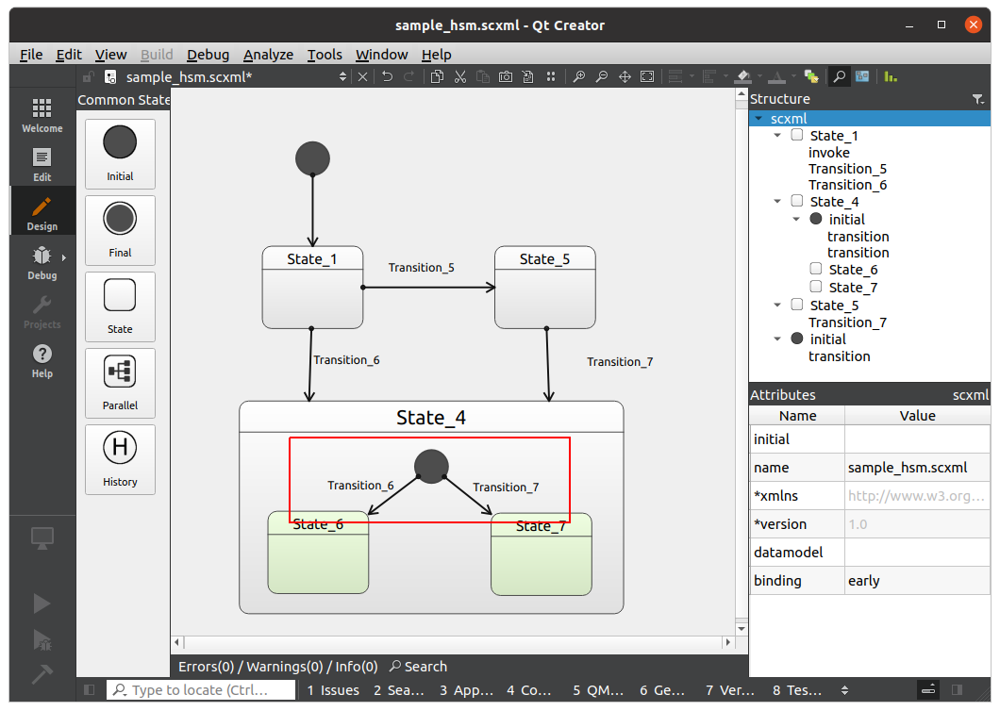